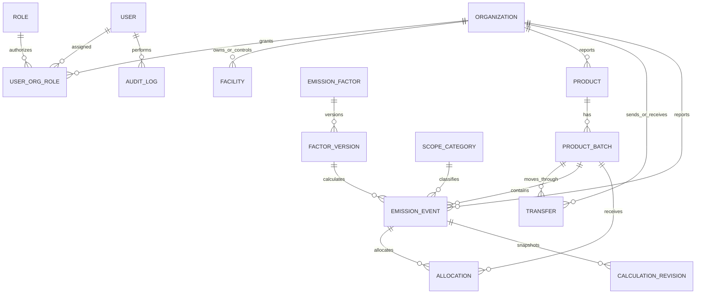

# Proposed relational ER model (design target)

This diagram is the target architecture, not a claim that all tables/relationships have been implemented. The current prototype has a smaller set of JPA entities. Before final submission, align the diagram with the actual schema and migrations.
